# EffMeet2 装机图解 · 从零到开机（2026-10-20 修订版）

**只看这一本就能装好。** 从第 1 步做到第 37 步，机器人装完、能开机。
每一步都写清了：**这一步在干嘛 → 怎么做 → 装完长这样 → 怎么算合格 → 别踩的坑 → 用哪颗螺丝**。
本版新增：每步的"装完后"状态图（灰模渲染，电子件用蓝灰色标出）、步骤之间的衔接说明、以及**阶段 C 开头的 P03 装配决策门**（务必先看，它决定传动段怎么开工）。

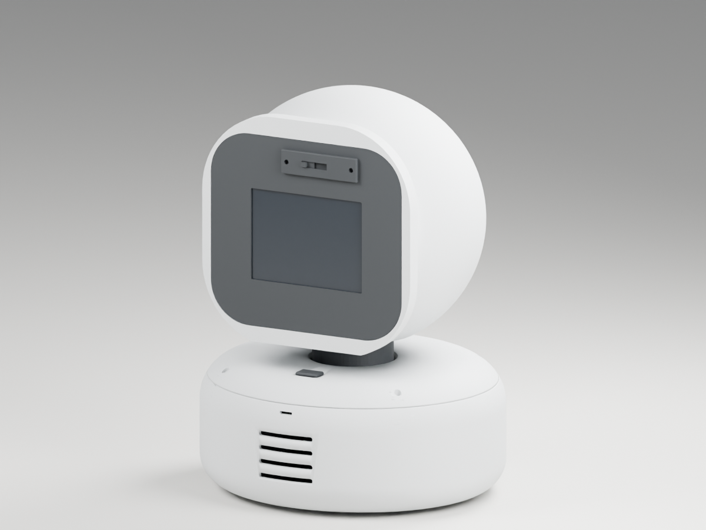
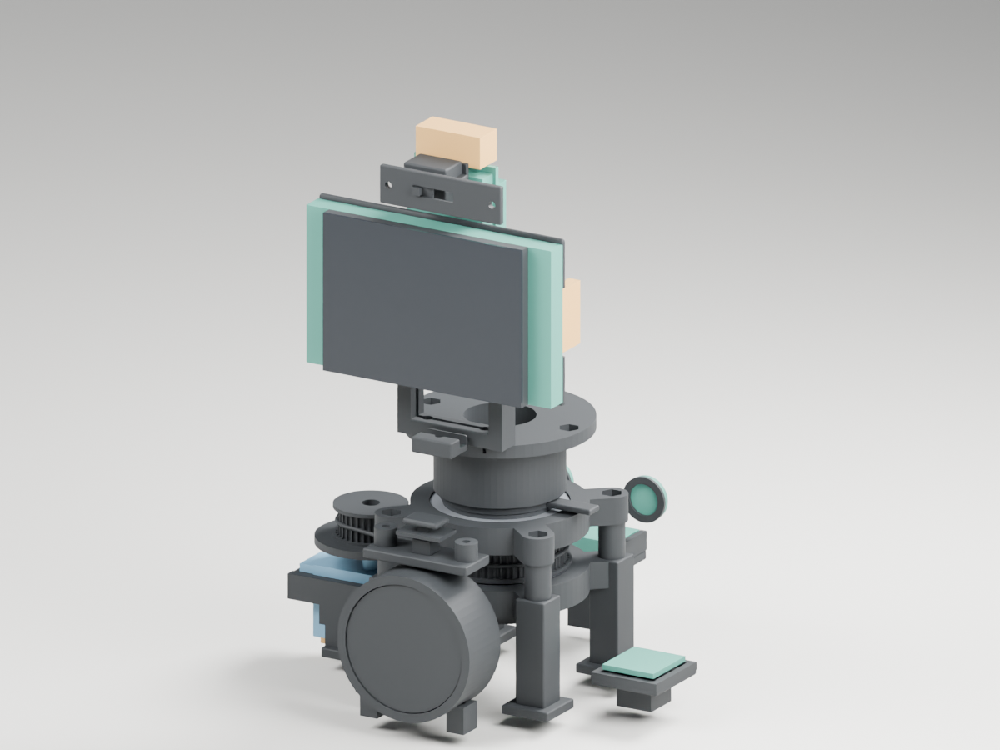

## 一、先认识它：三个部分

| 部位 | 是什么 | 里面有什么 |
|---|---|---|
| **底座**（下面的大碗） | 不动，稳放桌上 | 2 个麦克风、1 个喇叭、1 块功放小板、转向马达、按键、电线 |
| **脖子**（中间转的） | 让头左右转 ±45° | 1 根空心大轴、2 个大轴承、大小齿轮＋皮带 |
| **头**（上面的球） | 脸和"眼睛" | 屏幕、摄像头、1 块核心板（小电脑） |

**动力怎么传到头**：底座里的马达（MG90S）→ 小齿轮（32 齿）→ 皮带 → 大齿轮（64 齿）→ 空心大轴 → 脖子 → 头。整条链 2:1 减速，头转 ±45°、48° 处有硬挡。

## 二、开工前先备齐

### 零件对应表（32 个打印件 · 认件 + 装在哪一步）

| 件号 | 照片 | 名称 | 数量 | 装在哪（步骤） | 版本/备注 |
|---|---|---|---|---|---|
| P01 | 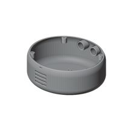 | 底座杯体 | 1 | 全程外壳（5–21） | v6r3 后 USB-C 窗 |
| P02 | 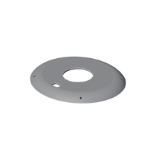 | 底座上盖＋限位块 | 1 | 21（盖碗） | ⚠️ 接缝裂→步骤 4 补救；48° 硬挡靠它 |
| P03 | 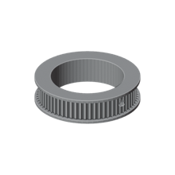 | 从动 64T 大齿轮 | 1 | 17（两轴承之间） | ⚠️ **装配决策门**（阶段 C 开头） |
| P04 | 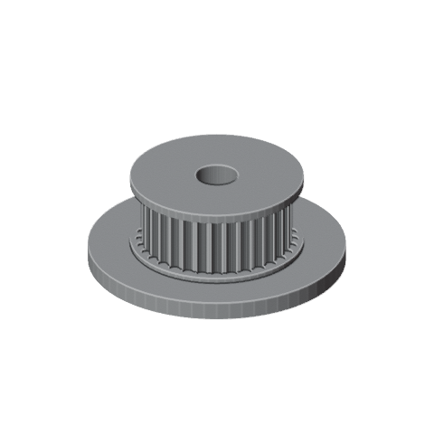 | 主动 32T 小齿轮 | 1 | 17（马达头） | 套 MG90S 舵盘 |
| P05 | 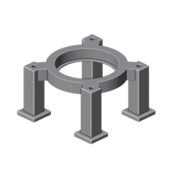 | 承力塔＋下轴承座 | 1 | 11–12 | 四腿坐碗底 |
| P06 | 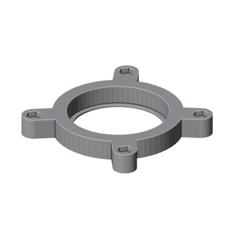 | 上轴承座 | 1 | 14 | 压上轴承、盖柱顶 |
| P07–P10 | 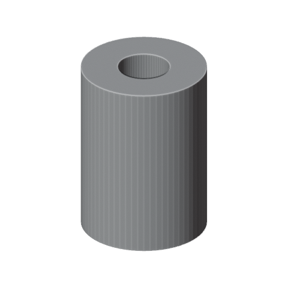 | 轴承层间支柱 | 4 | 13 | 8.2×8.2×11.4，四角各一 |
| P11 | 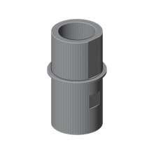 | 空心承力轴 | 1 | 15 | Ø22 走线孔；轴肩 z60 |
| P12 | 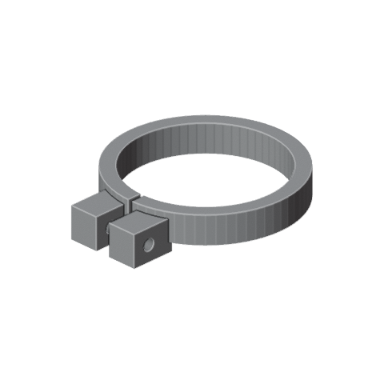 | 下止推夹环（开口） | 1 | 16 | 抱轴＋上止推 |
| P13 | 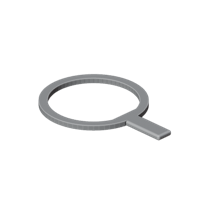 | 限位摆臂 | 1 | 18 | D 孔键位环，**无紧固件** |
| P14 | 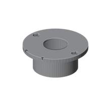 | 短颈＋法兰 | 1 | 22（脖管） | 有 PETG 替身件 |
| P15 | 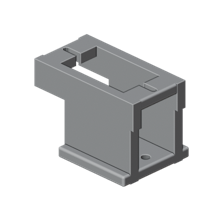 | MG90S 舵机耳架 | 1 | 8 | v6r3 让位槽；底板只用 M3×6 |
| P16 | 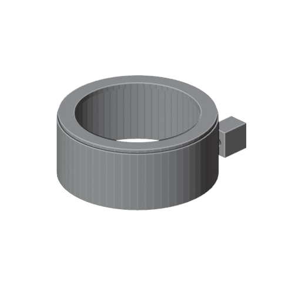 | 扬声器托架 | 1 | 7 | 振膜朝前 |
| P17 | 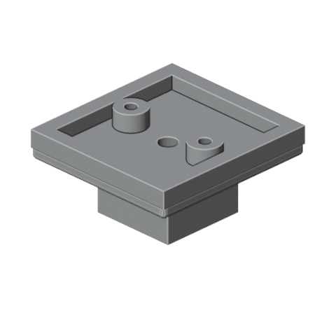 | 功放托盘 | 1 | 6 | 两 M2 柱距 12.6 |
| P18T | 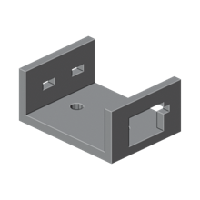 | USB-C 输入板托架 | 1 | 10 | **无独立 STL**，只在打印盘里 |
| P19 | 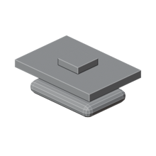 | 停止键帽 | 1 | 28 | 压配，松了点胶 |
| P20 | 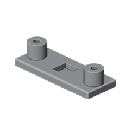 | 轻触开关托座 | 1 | 9 | ⚠️ 立柱断→胶固 |
| P23 | 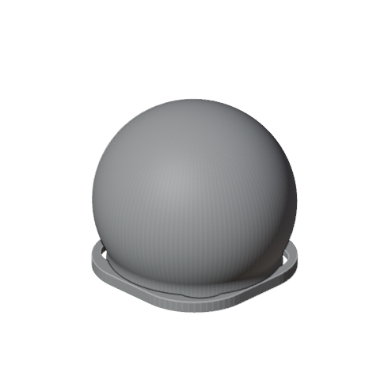 | 头壳（FACEFLAT） | 1 | 29 | 大平脸前口，单边 0.3 压配 |
| P24 | 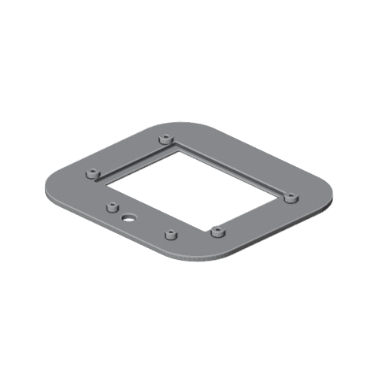 | 大平脸面板 | 1 | 24（＋30 压入） | 四柱 77×45、屏窗 62×46、镜头孔 **6.8** |
| P25 | 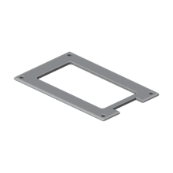 | LCD 后压框 | 1 | 24 | 4×M2.5×16/18 |
| P26 | 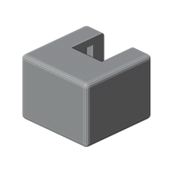 | 摄像托架 | 1 | 25 | v6r3；**必须配 P33** |
| P27 | 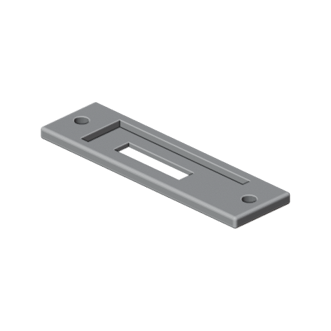 | 隐私滑盖导轨 | 1 | 27 | RETAINFIX，挡墙 0.8 |
| P28 | 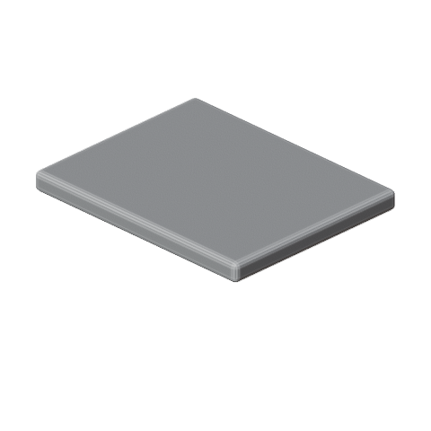 | 隐私滑片 | 1 | 27 | 槽内滑动，不是盖上滑 |
| P29 | 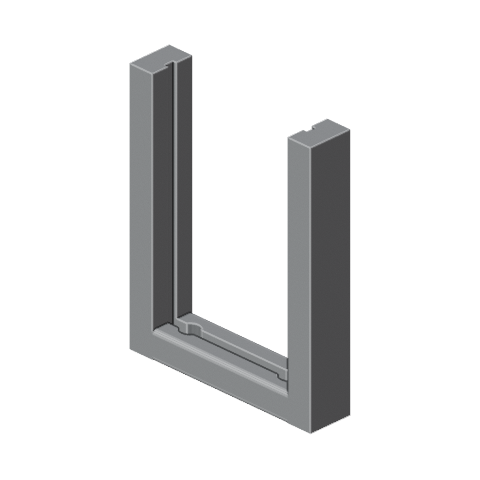 | 核心板托架 | 1 | 23 | EDGEGRIP：槽 1.7/咬边 0.6 |
| P30 | 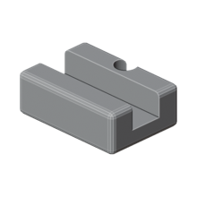 | 线鞍 底座侧 | 1 | 31 | 扎带绕槽不扎紧 |
| P31 | 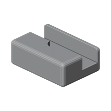 | 线鞍 头侧 | 1 | 31 | 同上 |
| P32 | 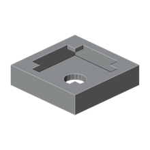 | 麦克风胶座（**本方案不用**） | 2 | — | 杜邦贴壁替代；无独立 STL，留备用 |
| P33 | 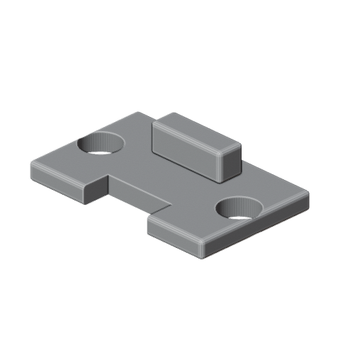 | 摄像头背板 | 1 | 25 | v6r3 新增，压模组 |

> 合计 **32 个**（28 行；P07–P10 算 4 个、P32 算 2 个）。P21/P22 已作废、不装。

### 螺丝包（先挑出来放一堆，后面每次用都从这里拿）

| 用在哪 | 长什么样 | 数量 | 白话 |
|---|---|---|---|
| 塔座压紧 | **M3×55–60**（最长的） | 4 | 配 4 个螺母从碗底拧 |
| 盖上盖、装脖管 | **M3×8/10** | 8 | 中等长度，各 4 颗 |
| 固定核心板托架 | M3×6/8 | 2 | |
| **马达座底板** | **M3×6** | 2 | ⚠️ 只能用 6！长的会顶线 |
| 小背板（压摄像头） | **M3×8 自攻** | 2 | 不用螺母，直接拧进塑料 |
| 底部开口夹环 | M3×10/12 | 1 | |
| 马达耳朵 | **M2×6/8** | 2 | 用马达盒里自带的 |
| 功放小板 | M2×4 | 2 | 最小的 |
| 锁齿轮顶丝 | **M2 顶丝** | 4 | 侧面顶进轴的小螺丝 |
| 屏幕压框 | **M2.5×16/18** | 4 | 细长的 |
| 螺母 | M3 螺母 | 4 | 给塔座 |

### 工具（缺哪样先补，带 ⚠️ 的是没有就做不了对应步骤）

| 工具 | 用途 |
|---|---|
| 内六角扳手 2.0＋2.5、小十字螺丝刀 | 全部螺钉 |
| 热熔胶枪＋胶棒 | P20/P32 固定、临时定位 |
| 焊台＋焊锡＋热缩管（可选） | **只需喇叭端 2 点**（功放端若焊盘再 +2）；其余全杜邦、0 焊（见下「11 根跨轴线的连接方案」） |
| 万用表（通断/蜂鸣档） | 第 33 步短路检查（必做） |
| 卡尺（或量角器＋手机角度 App） | 全部试配判据、第 18 步 ±45°/48° 核对 |
| **⚠️ 5mm 泡棉/胶块** | 第 18 步合盖前的临时硬挡 |
| **⚠️ EPDM/硅胶片材 1–2mm** | 第 7 步喇叭缘垫要自己剪 |
| 生料带、砂纸、镊子、扎带、记号笔 | 松紧修正/理线/标记 |
| 5V≥2A 充电器＋Type-C 线 ×2 | 供电/烧录 |
| **⚠️ 舵机独立 5V 稳压（可调/UBEC）** | MG90S 供电，**不许用核心板 3.3V** |
| **⚠️ 电脑＋串口线** | 第 34 步看固件日志、后续配网 |
| LCD 14 针排线（GOOUU 套装内） | 屏与核心板 |
| **11 根** 20–30cm 杜邦线（或 28AWG 细软线） | 跨轴线束（见下连接方案） |

### 11 根跨轴线的连接方案（全杜邦 · 唯一焊点=喇叭）

**跨轴定为 11 根**：麦和功放各用**一对 I2S 时钟**（保留昨晚已验证的固件）；功放 SD 在模块端接 5V 常开、**不跨轴**（固件 GPIO18 悬空，代码翻转无效果、不影响出声）。

| # | 线 | 底座端 | 头部端（核心板排针） |
|---|---|---|---|
| 1 | 5V | 供电入口＋功放 VIN | 5V |
| 2 | GND | 底座全部共地 | GND |
| 3 | 3V3 | 两只麦 VDD | 3V3 |
| 4 | MIC BCLK | 两只麦 SCK（并线） | GPIO4 |
| 5 | MIC WS | 两只麦 WS（并线） | GPIO5 |
| 6 | MIC SD | 两只麦 SD（并线，L/R 分左右槽） | GPIO6 |
| 7 | AMP BCLK | 功放 BCLK | GPIO15 |
| 8 | AMP WS | 功放 LRC | GPIO16 |
| 9 | AMP DIN | 功放 DIN | GPIO17 |
| 10 | SERVO PWM | 舵机橙线 | GPIO38 |
| 11 | KEY | 停止键（另一脚接地） | 空闲非启动脚 |

**连接方式（唯一焊点：喇叭 2 点）**

**麦克风（0 焊，P32 照用）**
- 模块带排针：**针朝碗内**放进 P32 腔粘好——腔深 4.2mm 装得下模块本体，排针向碗内凸出是允许的（不顶杯壁、不碰 P32 的 Ø6 声孔）；
- 杜邦从内侧插排针；两只麦共用的 **3V3 / GND / MIC BCLK / MIC WS / MIC SD** 用杜邦"一分二"或一小段 2.54 排针做母线；
- **L/R**：一只短跳线接 GND（左），另一只接 3V3（右）。

**喇叭（唯一焊点）**
- 两个焊片各焊 1 根线；另一端到功放 **+ / −**（功放若是螺钉端子就直接拧上）。
- 演示可先用鳄鱼夹，装壳前必须复查夹紧与绝缘。

**其余全部 0 焊（杜邦/成品转接）**
- 头端 11 根：杜邦**母头**直插核心板排针；
- 功放：5 根母对母＋**SD→VIN 短跳线**；
- 停止键：母头直插 4 脚＋热熔胶点固；
- 舵机：1 根**公对母**（公头插舵机母座，母头插板）；
- 供电：**成品 USB-C 5V 转接线**，不用 E17；
- 摄像头 FPC、LCD 14 针：插座直插。

**穿轴与风险**
- 选 20–30cm 杜邦；单个母头约 2.5×5mm，可逐个穿过 Ø22；
- ⚠️ 杜邦不是最终动态线束：头转 20 次后复查，正式件换 28AWG 硅胶软线（WIRE-01 未冻结）。

**施工顺序（照这个来）**
1. 麦装 P32（杜邦）→ 功放杜邦＋SD 跳线 → 喇叭焊 2 点（或夹）；
2. **桌面先测**：跑 `mic` / `tone` / `servo` / `led`，确认不虚接；
3. 第 20 步穿 11 根 → 第 21–22 步合盖装脖；
4. 第 29 步进头后**只插杜邦、不焊**。

**双麦提醒**：固件当前是单声道、只取一个槽；两只麦都接上后只有 L（或 R）那路进转写。双麦都参与需后续固件改立体声/双通道（记待办，不阻塞装配）。

**连接纪律**：插到底、套热缩/点胶防脱；INMP441 的 L/R 必须一左一右。

### 名词小词典（看到不懂的词回来查）

| 手册里写的 | 意思 |
|---|---|
| **P15、P24 编号** | 零件"身份证号"，每步都有图 |
| **M3×8、M2×4** | 螺丝：M 后=粗细（毫米），×后=长度。M3≈圆珠笔芯粗 |
| **自攻螺丝** | 不用螺母，直接拧进塑料孔里咬住 |
| **顶丝** | 从侧面顶进去的小螺丝，锁住转轴不打滑 |
| **轴承** | 大号滚珠圈，让头转得顺 |
| **FPC / 排线** | 摄像头的**黄色软排线**——禁裁、禁折死 |
| **对角拧** | 像卸汽车轮胎：对角轮流拧，别一次拧死 |
| **D 平面 / D 孔** | 轴上削平的一块配齿轮/摆臂上的平边孔，防止打滑 |
| **轴肩** | 轴上凸起的一圈台阶，用来挡住轴承往下掉 |
| **唇** | 轴承座孔底部的窄边，托住轴承不掉下去 |
| **锥面自锁** | 两个斜面压进去自己卡紧，不用螺丝 |
| **张紧** | 调皮带松紧。"留 2mm"=还能前后挪 2 毫米 |
| **热熔胶点固** | 胶枪点一小坨固定 |
| **蜂鸣档** | 万用表上两表笔相碰会"嘀"的档位，测短路 |
| **合格标准** | 做到什么程度算过关；不满足就停、拍照、问人 |

---

## 三、开始装

### 阶段 A · 开工前准备（步骤 1–4）

**目标**：东西齐、工具齐、心里有数。

#### 步骤 1 · 把零件全部摆上桌

打印件一共 **32 个**（件表 28 行，其中 P07–P10 是 4 根、P32 是 2 个）。对着上面「零件对应表」逐行点名：认一个、放一个，缺的记在纸上。**特别留意**：P32 麦克风胶座是 **2 个**、P18T 也只在打印盘里（都没有独立 STL）；缺件别慌——工程手册 §0.6 写了替代法。

**合格标准**：32 个件都在桌上；缺的件记在纸上。

#### 步骤 2 · 工具备齐

按上面"工具"表摆好。11 根线先备好杜邦（第 20 步穿轴用）。焊台只为喇叭 2 点，用时再热。

**合格标准**：手边摸得到，不用中途跑。

#### 步骤 3 · 三个"摸一摸"试配（全程用手感，硬压就是错）

1. **轴承圈**：先套一下大轴的粗段（Ø29.8 那段）——要**能顺滑滑落**；再试塔座的轴承孔——要**用拇指轻压才进**。
2. **马达自带的白色舵盘**放进小齿轮的方槽里试一下。
3. **屏幕的 4 个孔**对一下黑脸板背面的 4 个柱（横 77 × 竖 45）。

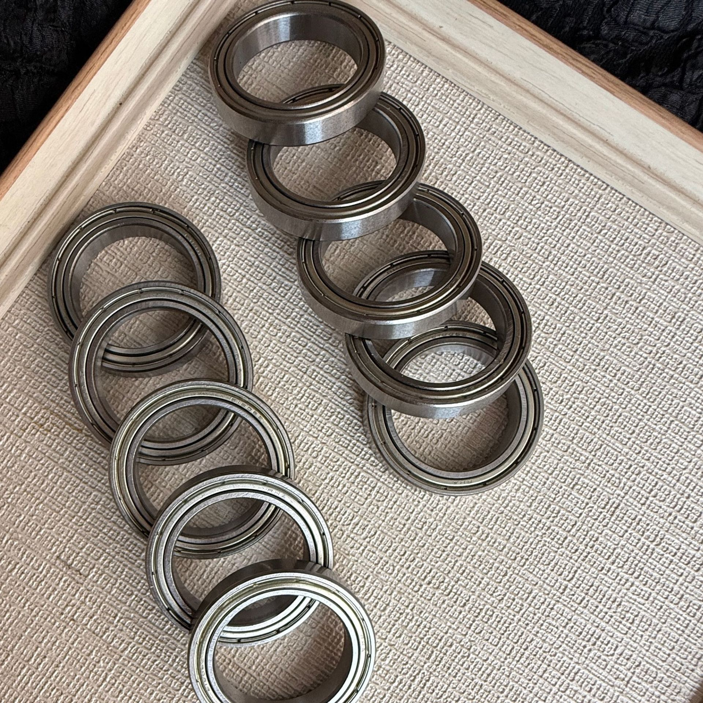

**合格标准**：轴段顺滑下落；座孔轻压入、不是一放就掉；舵盘进槽；屏孔对得上。

⚠️ 座孔"一放就掉"= 太松，后面要缠生料带；轴段"下不去"= 磨轴（砂纸）。**轴承本身不许敲、不许压内圈。**

#### 步骤 4 · 有两件可能带伤，先救

- **上盖裂了**：两半对位（中间 44 的大圆圈必须完整），裂缝里涂胶（CA/环氧），压重 30 分钟。加固法：从顶面**垂直往下**钻 4 个 Ø2 小孔**穿进下圈壁**，插一段耗材当"钉子"再涂胶——钻孔要**避开中间的大圆圈和边上 4 个螺丝柱**，只钻 3 毫米厚的圈壁。
- **开关座小柱断了**：没关系，第 9 步用胶枪固定开关就行。

**合格标准**：上盖能平放、大圆圈完整；开关座没柱也能用。

### 阶段 B · 底座里装电子件（步骤 5–10）

**目标**：麦克风、喇叭、马达、开关、供电，全装进大碗里。
**衔接提醒**：这一阶段只做**模块端**（杜邦插好），另一头全部留着——它们就是第 20 步要穿进大轴的 11 根线。别提前接"控制板"，控制板第 23 步才装进头里。

#### 步骤 5 · 装两个麦克风（P32 胶座，杜邦 0 焊）

**麦模块带排针 → 杜邦，0 焊；P32 照用。**

1. 模块本体放进 P32 腔，**底面小孔对 P32 的 Ø6 声孔**；排针**朝碗内**（凸出一点是允许的，不顶杯壁）；
2. 只沿 P32 底**外圈**点热熔胶，罩住碗内壁 Ø2.4 声孔压 10 秒（别堵声孔）；
3. 左碗一个、右碗一个；**L/R 看丝印**：一只短跳线接 GND、一只接 3V3；
4. 杜邦从内侧插排针，线沿内壁走向底座母线。

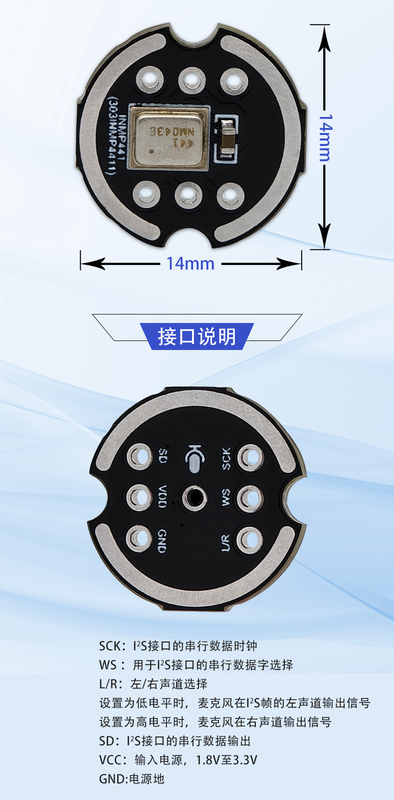
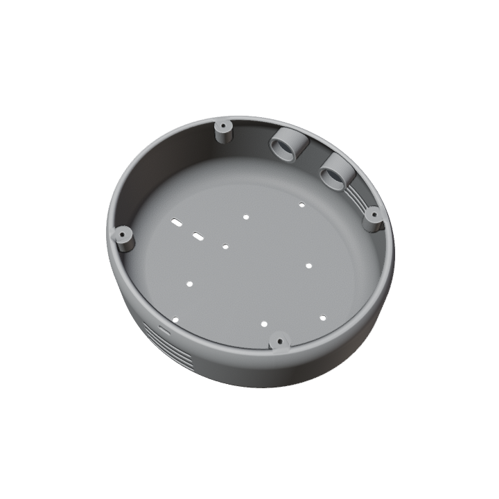

**装完后长这样**：胶座贴在杯内壁上，麦模块基本被盖在座里看不见——**只要声孔同心、摇不晃就对了**（渲染图里只能看到壁上的孔位，这是正常的）。

**合格标准**：小圆板不晃；两个圆孔同心；胶没流进孔里。

⚠️ 胶堵住小孔=麦克风变聋。只涂外圈。

#### 步骤 6 · 装功放小板＋接线（P17 托盘）

小板放托盘，两个孔对两个小柱（**柱距 12.6mm**，对不上=托盘拿反了），M2×4 两颗轻轻拧住。然后接线（杜邦）：

| 小板上的字 | 接什么 |
|---|---|
| **Vin / 5V** | 电源正极（5V） |
| **GND** | 地线 |
| **LRC / WS** | 时钟线 |
| **BCLK** | 位时钟线 |
| **DIN** | 数据线（来自主控） |
| **GAIN** | 悬空=默认增益，不用接 |
| **SD** | 悬空=有信号自动使能，不用接 |

**接线（0 焊，前提：功放板已焊排针）**：Vin、GND、LRC、BCLK、DIN 五根全用杜邦母对母；**SD 用一根短跳线接 Vin（5V）常开**；GAIN 悬空=默认增益。这几根（5V/GND 与功放专用 LRC/BCLK/DIN）都属第 20 步跨轴线的 11 根，另一端第 29 步进头后插核心板。

喇叭两根线接到功放 **+ / −**：模块带螺钉端子就直接拧；只有焊盘才需在功放端补焊。喇叭只接这两个，**不接地、不共地**。

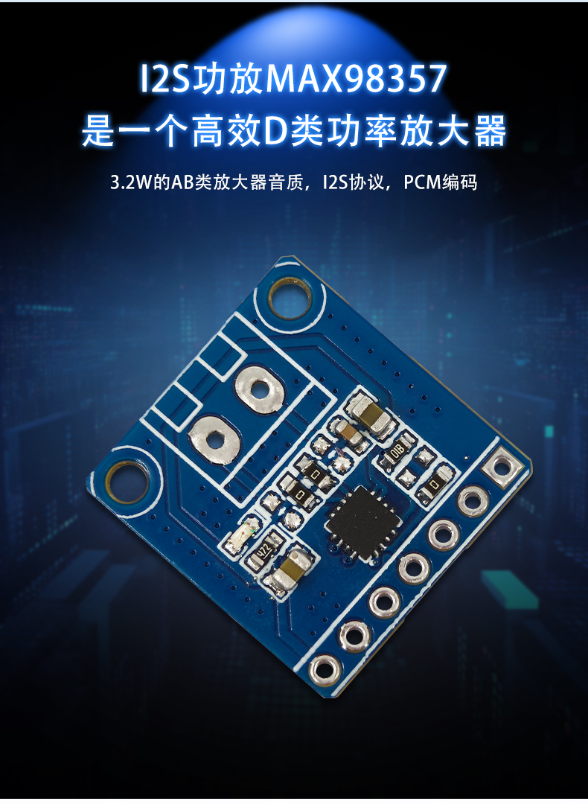
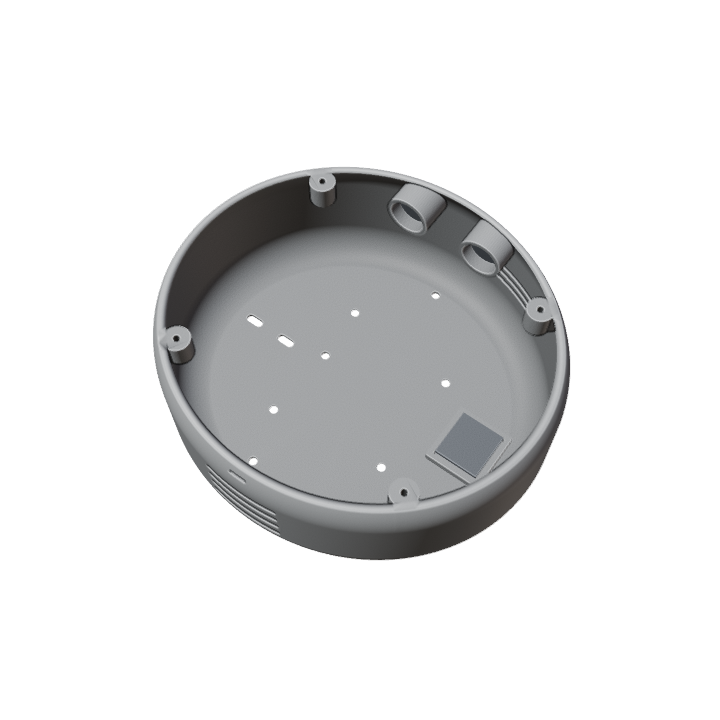

**合格标准**：板贴平不翘；线不绷；杜邦插到底不松。

#### 步骤 7 · 装喇叭（P16 托架）

**有纸盆（会动的那面）朝外朝前**放进圆环，边上垫一圈**自己剪的 EPDM/硅胶垫**（1–2mm 片材，剪一圈环），焊片朝后接线。**喇叭端 2 点（功放端若焊盘再加 2；多为螺钉端子）**：两个焊片各焊一根线到功放 + / −；喇叭自带线/端子则免焊。

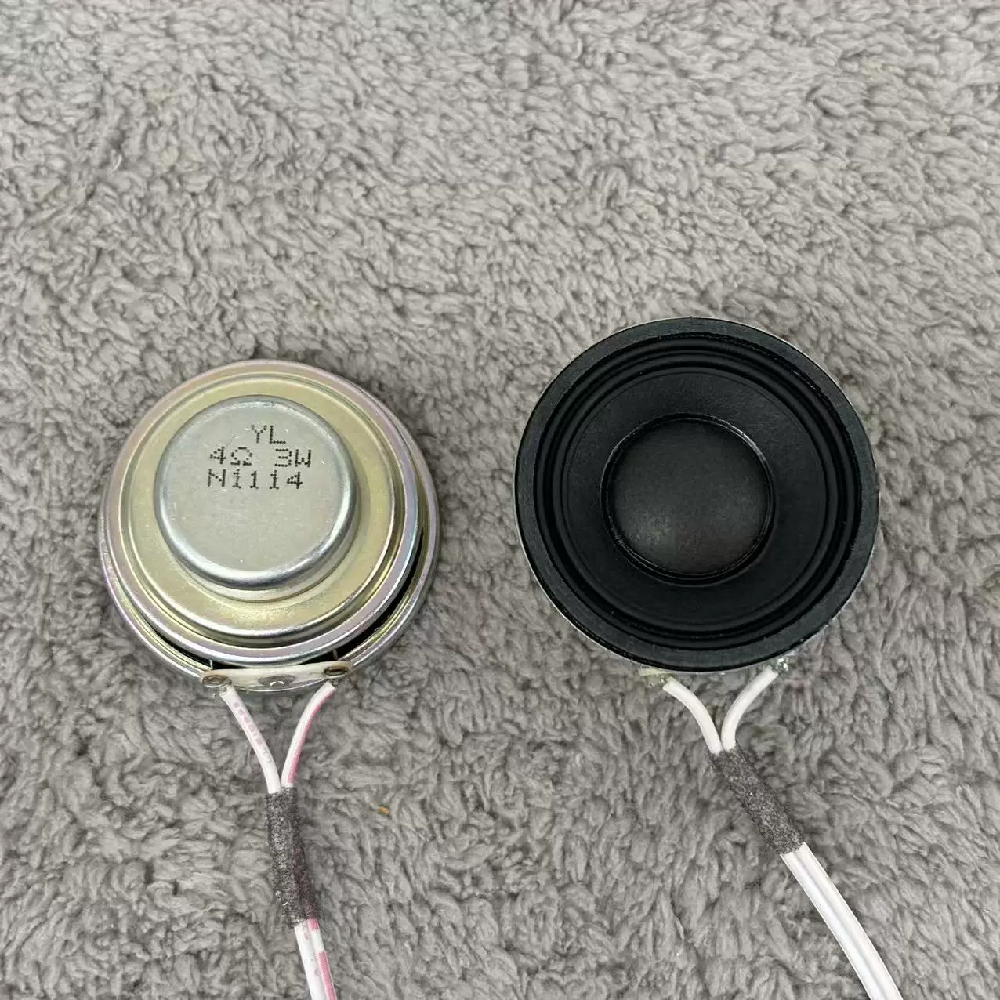
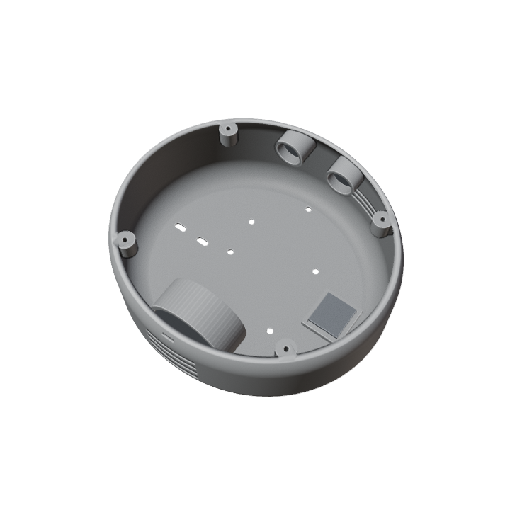

**合格标准**：手按不晃；纸盆不碰壁；总厚不超过 17 毫米。

⚠️ 垫圈压到纸盆=破音。

#### 步骤 8 · 装马达（重点，容易翻车）

1. **先把马达的三色线从座子尾部的缺口槽（约 6.8mm 宽）穿下去**——不穿槽直接放=塞不进，这是新手第一坑；
2. 马达按进槽里，能轻轻滑动就对了；两只"耳朵"的孔对座子的孔，用**马达自带的 M2 小螺丝**穿上，**先别拧死**（第 19 步还要前后调皮带松紧）；
3. 翻过来从碗底拧 **2 颗 M3×6** 固定座子。

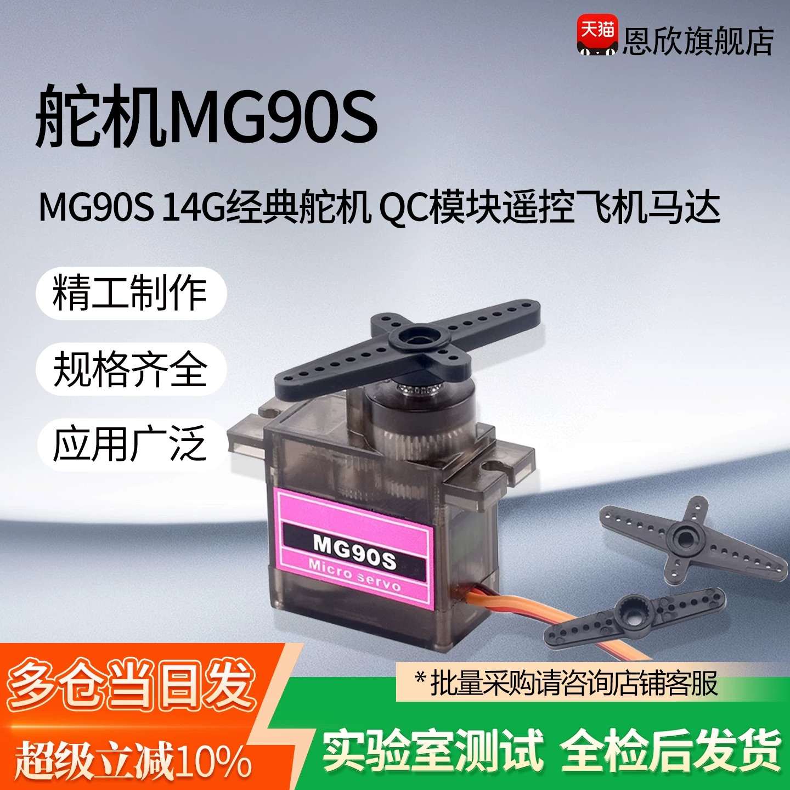
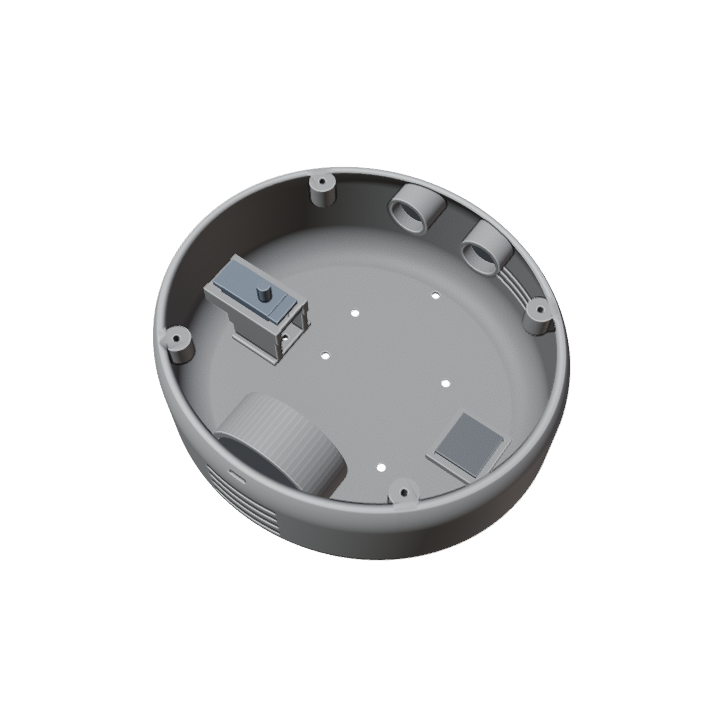

**合格标准**：马达能滑动、不晃；线从槽里自然垂到碗底，不被夹住。

⚠️ 底板螺丝只能用 **M3×6**。用 8 或 10 的，螺丝尖会伸进来顶住线——现象和"塞不进"一模一样。

#### 步骤 9 · 装停止键（P20 托座）

小开关按进座子的方槽（槽只有 1.8mm 深），**一定要用胶枪点一坨胶**固定。**按杜邦接（0 焊）**：杜邦母头直接插开关脚（0.6mm 方脚偏松：脚上套段热缩或轻夹母头弹片），插好后**热熔胶点固**防脱。两脚一接底座地、一接 **KEY 线**（第 20 步 11 根之一）；另一头留空，第 29 步进头后才接核心板**空闲非启动脚**。键帽最后再按（第 28 步）。

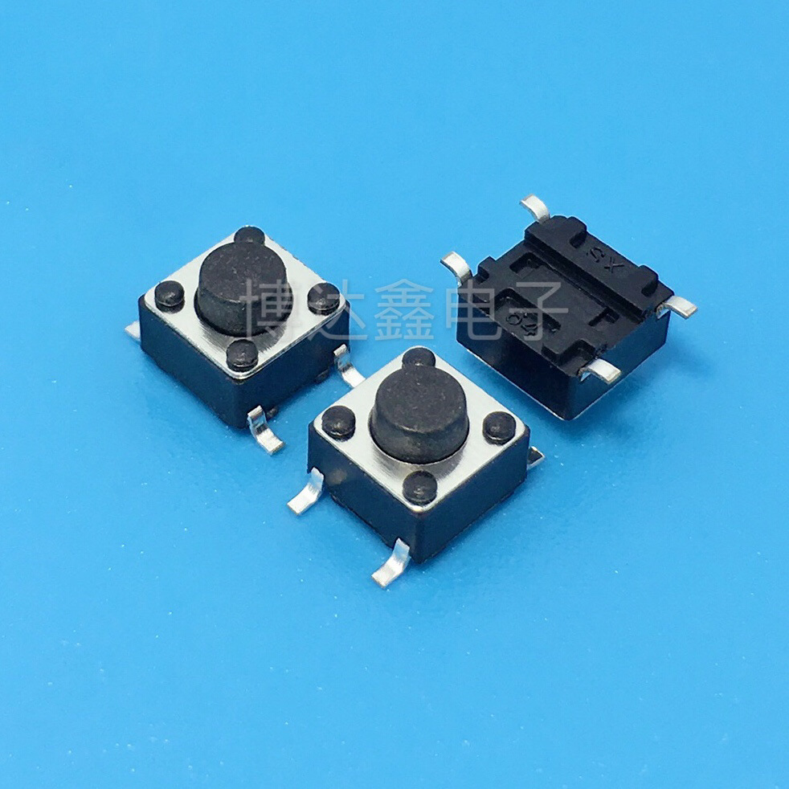
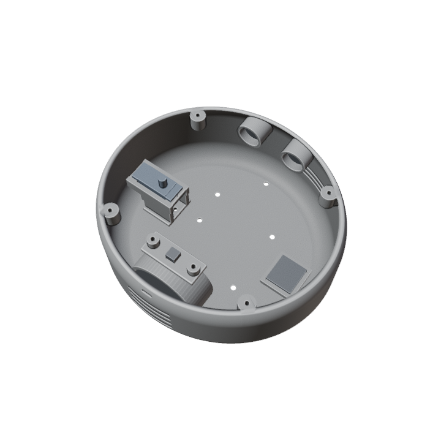

**合格标准**：按键按下去有"咔哒"；胶没糊住按键帽的位置。

#### 步骤 10 · 装供电小板（P18T 托架）

**零焊做法**：用一根**成品 USB-C 5V 转接线**（USB-C 公头转两根线/端子），从碗后窗引入，5V/GND 接底座母线；P18T 托盘用于固定插头。E17 输入小板未选型，本方案不装。**注意**：P18T 没有独立模型文件，渲染图里这一步可能缺件——以实物为准。

**装完后长这样**：小板卡在碗后壁的方窗位置，插拔充电线板子不动。（本步无渲染图：P18T 没有独立模型文件，场景里渲染不出来，以实物为准。）

⚠️ 供电规矩：马达的电和核心板的电**不许从同一个 3.3V 出**；两边的地线要连在一起（共地）。没有供电小板时：5V 从后面直接引到头部核心板，碗里只留马达的电。

**合格标准**：插拔充电线小板不位移。

### 阶段 C · 装"脖子"传动（步骤 11–19）

**目标**：立起大轴，让头能顺滑左右转 ±45°。

⚠️ **开工前必读：P03 大齿轮的装配决策门。**
按现行打印件实测，**P03 的最终位置（两轴承之间 z41–52）没有任何"直接塞进去"的路径**：法兰 Ø43.2 过不了上下轴承座的 Ø42.3 座孔和 Ø38.4 唇；D 形内孔又必须沿轴滑入，而轴肩 Ø34.5 比孔的 Ø30.1 大。这不是手法问题，是设计上的装配悖论。开工前二选一：

- **路径 1（手工，今天可装）**：把 P03 内孔从 Ø30.1 **扩到约 Ø35（磨掉 D 平）** → 第 15 步落轴**之前**，先把 P03 从两轴承座之间的侧面缝隙放进去 → 轴落下时轴肩从它的孔里穿过 → 第 17 步调高度、顶丝顶到轴的 D 平面上。代价：孔径大、侧隙约 2.5mm，靠皮带张力自定心；手工扩孔精度要求高。
- **路径 2（改模型重打，约 1–2 小时）**：把 P03 改成**左右对开两半**（抱轴式，2 颗 M2 螺钉合抱），在第 17 步从缝隙里合抱到轴上。P11/P06 一字不动，最稳；代价要先改 `build_v6.py` 重打小件。

两条路径的详细操作都写在**步骤 17**。**路径 1 必须在步骤 15 之前完成 P03 扩孔**——先选好再开工。

#### 步骤 11 · 立塔座＋干装量高

**这一步是"试堆叠量高度"，不是最终安装。** 动作：

1. 塔座（带四条腿那个）四腿坐进碗底；
2. 把 **上座 P06、4 根长螺丝、4 根小立柱**都拿过来，**干着**穿一遍：4 根 M3×55–60 从上座耳朵孔穿下去，穿过立柱位置、塔座四腿；
3. 量总高：**约 56mm**；
4. **量完拆散**——螺母先不上，正式安装从第 12 步重新来。

**正式装配的螺母**：4 个 M3 螺母要**先放进碗底的六角沉坑**（每个塔脚正下方；六角坑防转），**再落塔座**——塔座一落底就塞不进去了。之后第 14 步的长螺丝从上面穿下来、直接拧进这些螺母。

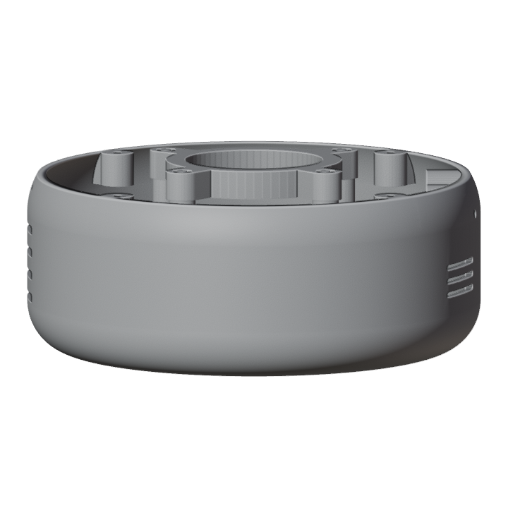

**装完后长这样**：正侧视能看到杯口以上露出上座和四根柱子的顶端，整体像一根短柱立在碗里，用尺量到顶端约 56mm。

**合格标准**：总高 56 毫米左右。

⚠️ 70 的螺丝太长，会多出约 14 毫米顶到桌面——剪短或垫垫片。**这一步不锁螺母，量完就拆。**

#### 步骤 12 · 装下面的大轴承（P05）

轴承平放到塔座孔上，**大拇指只压外圈**均匀用力，感觉"咚"一下到底、外圈和孔口齐平。座孔底下有一道窄"唇"，轴承就是坐在唇上的。

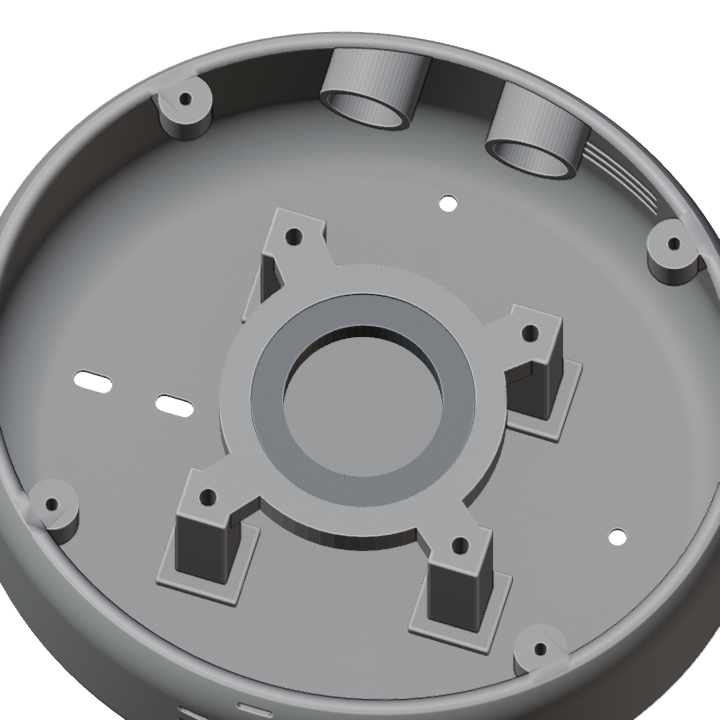

**装完后长这样**：塔座中央的孔里嵌着轴承，外圈端面与座口齐平；此时上座、柱子都还没装（图里只有塔座和轴承，是拆散后的正确状态）。

**合格标准**：外圈端面与孔口齐平。

⚠️ 紧了=停下来磨孔（砂纸/胶带鼓）；松了=缠 1–2 圈生料带或垫薄片；仍松点一滴胶（永久）。压内圈、敲打=直接报废。

#### 步骤 13 · 插四根小立柱

四角各一根，不分方向，直接立在塔座四角的柱位上。

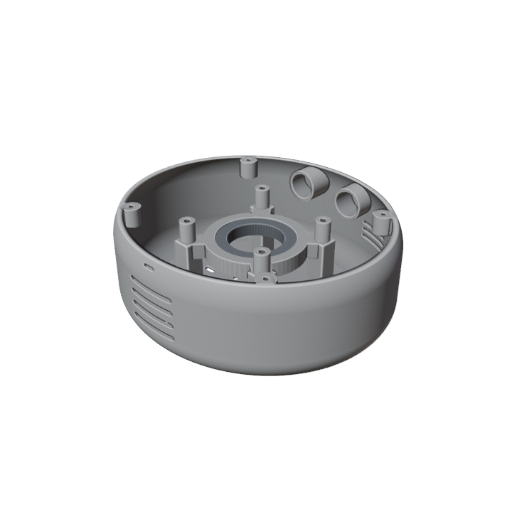

**合格标准**：四柱顶面平齐、轻推不晃。

#### 步骤 14 · 装上面的大轴承＋上座（P06）

1. 上轴承同样**只压外圈**，从 P06 顶面压进座孔，坐到孔底的唇上；
2. P06 盖到四根立柱顶上；
3. 4 颗长螺丝**对角轮流**拧（1-3-2-4）：每颗拧到手指拧不动，再**加 1/8 圈就停**。

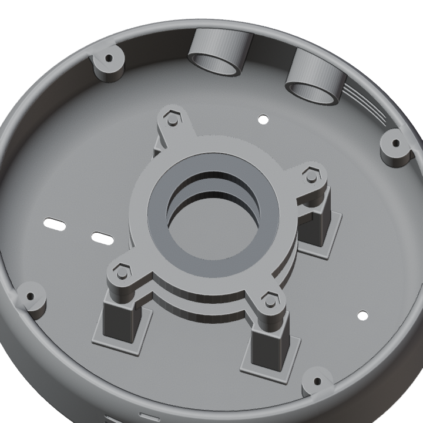

**装完后长这样**：上座压在四根柱子上，四颗长螺丝头露在上座四角，塔内上下两个轴承座孔同心。

**合格标准**：塑料没有发白，上座不晃。

⚠️ 拧过头塑料会白掉、几天后松脱。

#### 步骤 15 · 插大空心轴（P11）

1. 如果走**路径 1**：现在先把扩好孔的 P03 从两轴承座之间的**侧面缝隙**放进去（悬在中间，先不调位）；
2. 把 P12 开口夹环先**松着**套在轴底端（用胶带临时兜住别滑掉）；
3. 轴从上方**顺滑落下**穿过两个轴承内圈——**轴肩（轴上那圈凸台）坐到上轴承上端面就到底了**，这时轴底正好在塔座下腔里；
4. 注意轴上削平的 **D 平面朝上**方向；轴承坐在圆段上，不能坐在削平处。

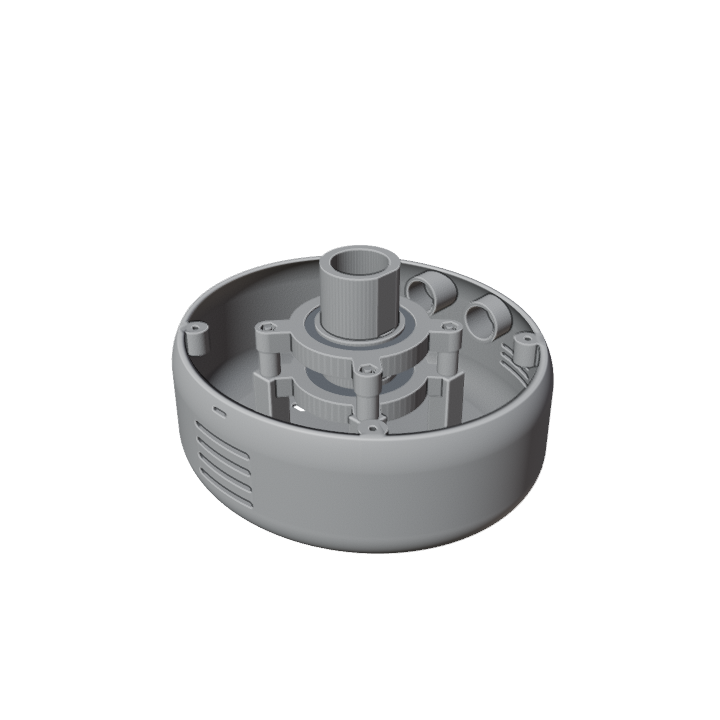

**装完后长这样**：轴从杯心竖起来，顶端高于上座；轴肩落在上轴承上（轴不能再往下掉），手扶轴顶能顺滑转。

**合格标准**：松手能靠自重落到肩台坐实；手转顺滑、不卡不晃。

⚠️ 紧了磨轴（砂纸）；松了缠生料带在轴上。**不磨轴承。**

#### 步骤 16 · 锁底部开口夹环（P12）

把轴底松着的夹环合拢到位，**M3×10/12** 一颗穿过两个夹块拧紧，锁到"手转有阻力但不卡"。夹环顶面会**向上顶住下轴承的内圈**——它是轴的"上止推"，别锁太高把轴顶起来。

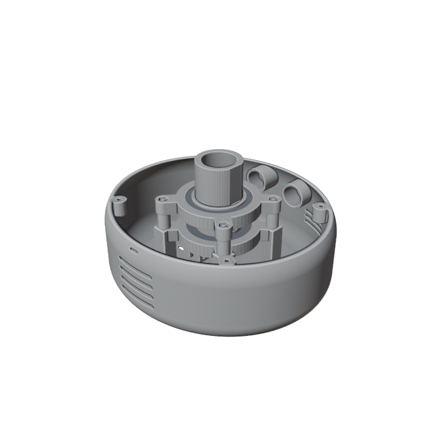

**合格标准**：手转轴有均匀阻尼感，没有死点；轴上下不窜动。

⚠️ 不许用顶丝去顶轴——顶出坑就废了。

#### 步骤 17 · 装大齿轮（P03）＋小齿轮（P04）【决策门】

按阶段 C 开头选的路径做：

**路径 1（P03 已扩孔、已在第 15 步侧放进缝隙）**：
1. 把 P03 沿轴滑到**两轴承座之间的正中**，让侧面的顶丝孔对准轴上的**驱动 D 平面**（那段 8.4mm 高的削平带）；
2. **M2 顶丝**（孔 1.5–1.6，先通毛刺）顶到 D 平面上锁死——顶丝会伸过扩大的孔咬住平面，这是防转+防滑的唯一依靠；
3. 转一下确认齿轮不打滑、能带动轴。

**路径 2（对开式 P03）**：
1. 两半从缝隙里合抱到轴上，对位驱动 D 平面；
2. 2 颗 M2 螺钉合抱拧紧，同样确认能带动轴。

**小齿轮（P04）两条路径相同**：把 32 齿的方槽套到马达自带的白色舵盘上，**M2 顶丝**顶住舵盘轴锁死。

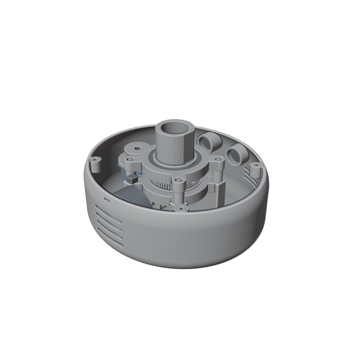

**装完后长这样**：两轴承座之间的缝隙里能看到大齿轮，马达那头是小齿轮，两者的皮带槽在同一高度（离杯底约 46mm）。

**合格标准**：齿轮不跟着手打滑；顶丝顶在 D 平面上（顶在圆面上会滑）；两轮皮带槽同高。

⚠️ 这一步是全机唯一没有"照做就行"标准动作的地方——**卡住就停**：齿轮带不动轴、或孔大得晃得厉害，就别硬上，拍张照回来讨论（可以补一个开口衬套）。

#### 步骤 18 · 装限位摆臂（P13）

**P13 是一个"键位环"**：D 形内孔套在轴的上段 D 平面上，**没有任何螺钉**，靠 D 面跟着轴一起转；它下面**不连任何东西**（早前"下端连夹环"的说法是误记，模型里两件相距 29mm、互不接触）。

1. 从轴顶把 P13 套下去，沿 D 平面滑到**平带的下沿**（它自己会停住，约在盖口下方）；
2. 它的凸耳朝外；手转大轴：**左右各转 45° 顺滑，转到 48° 会碰到硬挡**——硬挡来自上盖内侧的两个固定限位块（第 21 步合盖后生效）；
3. 合盖前没有限位块：用 **5mm 泡棉块**临时塞在凸耳运动路径上做临时硬挡，别用手扶着试。

**合格标准**：±45° 顺滑、48° 硬停（拿量角器或手机量角 App 核对）。

⚠️ 合盖后记得**拿掉泡棉**，硬挡改由盖内限位块接管。

#### 步骤 19 · 装皮带（GT2 188mm 闭环）

皮带套上两个齿轮，松开马达耳朵的 M2 螺丝**前后挪马达**把皮带绷上（能挪 2 毫米的量），再拧紧。

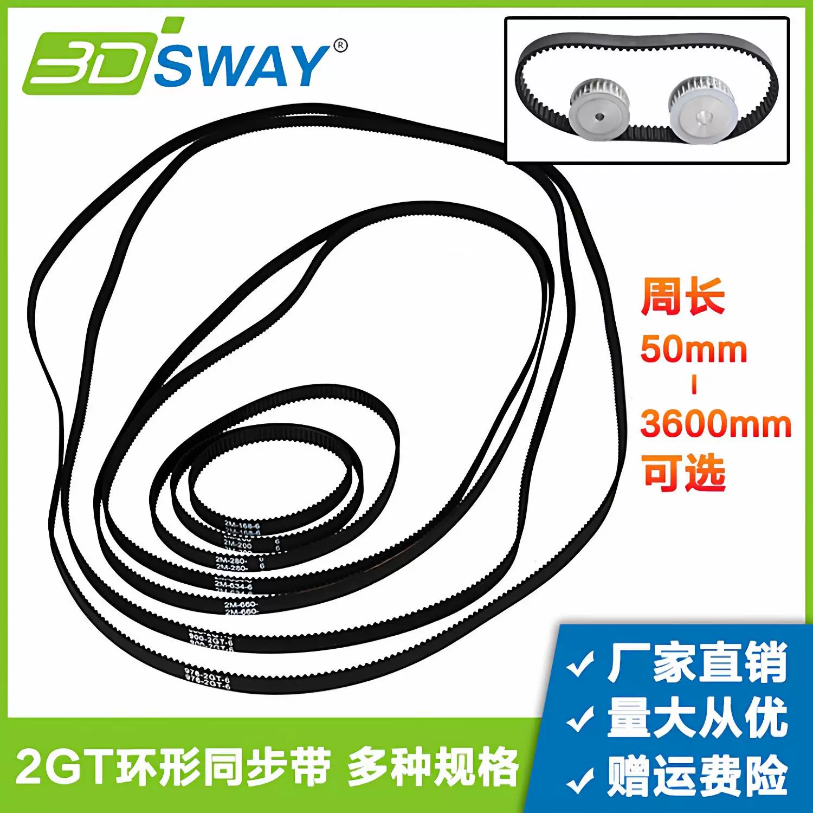
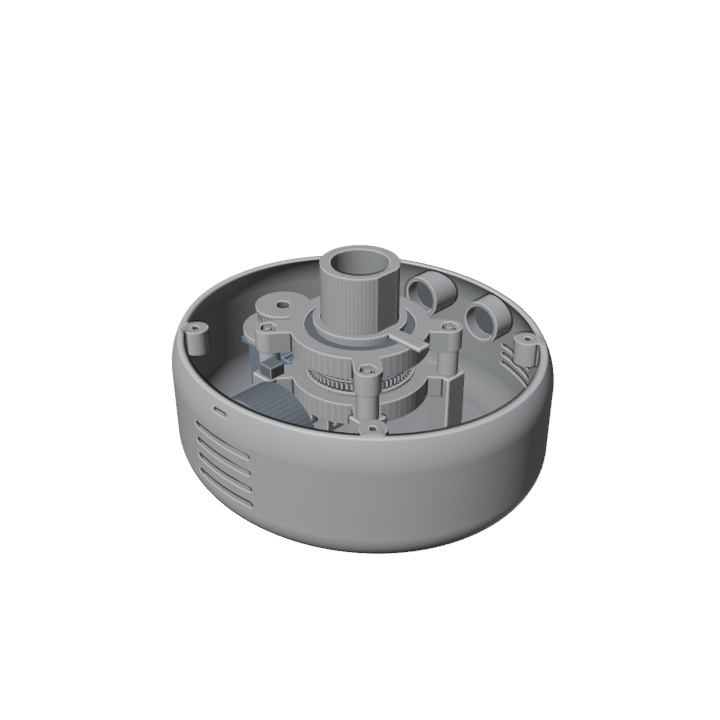

**合格标准**：皮带不打滑、转起来没有吱吱声。

⚠️ 皮带没到货就手转演示，**不许硬拽马达**。

### 阶段 D · 穿线＋盖盖子＋装脖子（步骤 20–22）

**目标**：11 根线穿进大轴，然后按顺序合起来。
**顺序铁律：线 → 上盖 → 脖子 → 头 → 最后才是脸板。顺序错=卡死。**

#### 步骤 20 · 穿 11 根线

11 根线（方案 1）：**5V、GND、3V3、MIC BCLK、MIC WS、MIC SD、AMP BCLK、AMP WS、AMP DIN、SERVO PWM、KEY**（功放 SD 已在模块端接 5V，不跨轴）。每根先套软护套，从大轴中间的圆孔（Ø22）自下而上穿上去，**最中心 Ø10 留空别塞**。

**两端去向表**（底座端前几步已接好，头端第 29 步才接）：

| # | 线 | 底座端 | 头部端（第 29 步） |
|---|---|---|---|
| 1 | 5V | 供电板 5V / 稳压输出＋功放 VIN | 核心板 5V |
| 2 | GND | 麦/功放/开关/舵机等底座共地 | 核心板 GND |
| 3 | 3V3 | 两只麦克风 VDD | 核心板 3.3V |
| 4 | MIC BCLK | 两只麦 SCK（并线） | GPIO4 |
| 5 | MIC WS | 两只麦 WS（并线） | GPIO5 |
| 6 | MIC SD | 两只麦 SD（并线，L/R 分左右槽） | GPIO6 |
| 7 | AMP BCLK | 功放 BCLK | GPIO15 |
| 8 | AMP WS | 功放 LRC | GPIO16 |
| 9 | AMP DIN | 功放 DIN | GPIO17 |
| 10 | SERVO PWM | 舵机橙线 | GPIO38 |
| 11 | KEY | 开关一脚（另一脚接地） | 空闲非启动脚 |

**"先不接插头"的意思**：前几步已经插好模块端；这一步只做穿线，**线束两头的杜邦/端子保持预压状态**，逐个穿过 Ø22 孔。

**装完后长这样**：轴顶的圆孔里露出一束细线，环顾一圈线是散的、没有绑死，中心 10mm 的空区还空着（图里线束很细，靠文字认位置）。

**合格标准**：11 根全上去了；线能自由抽动；中心禁入区没塞东西。

⚠️ 端子/插头若后压就会过不了轴孔——杜邦出厂已压好，逐个穿即可。

#### 步骤 21 · 盖上盖（P02）

上盖中间的 **44mm 大孔让线束穿出来**，盖到碗上；盖底下的突起（限位块）对准 P13 的凸耳运动路径；**4 颗 M3×8/10 对角拧**。合盖后：**拿掉泡棉临时挡**，再转一圈确认 48° 碰的是盖内限位块。

**合格标准**：盖平、缝合；线从孔里自由出来不被压；48° 硬挡生效。

#### 步骤 22 · 装脖管（P14）

线从脖管里穿上去；脖管底下的法兰盘坐到上盖上；管里削平的面对准轴的削平面，**M2 顶丝**锁住；**4 颗 M3×8/10** 拧法兰。

**怎么知道 D 面对准了**：顶丝**能顺利拧进去咬住**就是对上了；顶丝拧不动或空转=没对准，**别硬拧**——举起来对光看管内那段平面，转个角度再试。

**合格标准**：脖管不晃；转轴时脖管跟着转（它们是一体的）。

### 阶段 E · 装头（可以拿在手里装 · 步骤 23–28）

**目标**：屏幕、摄像头、小电脑装成"前脸"，最后整体扣进头壳。
**衔接提醒**：这几步是"前脸子装"，**不要**急着按进头壳——第 30 步才压。渲染图里前脸是悬在头部位置的，看起来像"爆炸图"，这是正常的。

#### 步骤 23 · 小电脑（核心板）入托架（P29）

竖着插进托架的槽（1.7mm 宽，耳槽会咬住板边 0.6mm——有点"咔"的手感就对了），**排线口/充电口那端朝上、露出约 10mm**，插到板边被耳槽咬住为止。2 颗 **M3×6/8** 拧到头壳底部的两个柱子上。

**封头前必做**：拿 Type-C 线插一次充电口——封上头就插不到了！

**合格标准**：板插到底不晃、拔不出来（耳槽咬住了）；上端露出约 10mm；充电线插得到。

#### 步骤 24 · 装屏幕

屏幕贴到黑脸板背面：4 个孔对 4 个柱（**横 77 × 竖 45**）。后压框盖上，**4 颗 M2.5×16/18** 从压框背面**穿过屏幕四角的孔**，拧进黑脸板的柱子，**拧到框贴上板就停**。

**合格标准**：从正面看，屏在窗口正中；**排针朝有摄像排线的那条短边**。

⚠️ 再多拧 1/4 圈就可能压碎玻璃。

#### 步骤 25 · 装摄像头（重点，五小步）

1. **镜头对孔**：把摄像头的小方块凑到黑脸板中间的圆孔（**6.8mm**）后面——镜头能探进孔里一点点就对了（它会自己找正）；
2. **排线先穿槽**：摄像头的**黄色软排线朝下**，先穿过小背板（P33）中间的槽；
3. **推入**：小方块推进托架腔里推到底，镜头对正圆孔；
4. **上背板**：小背板盖上（板上的小凸条正好压住摄像头背面），**2 颗 M3×8 自攻螺丝**拧到背板贴住**就停**；
5. **粘托架**：托架背面贴双面胶（或点胶），**贴到黑脸板背面**——这一步原来漏写了，不做的话前脸一拿就散。

**合格标准**：摄像头不晃不掉；托架已粘牢在脸板上；排线从槽里自由穿出，弯的地方是圆弧。

⚠️ 排线不许剪短、不许折死（折死=摄像头瞎）。⚠️ 自攻螺丝拧过头塑料柱会裂。

#### 步骤 26 · 合成"前脸一组"

黑脸板＋压框＋屏幕＋摄像托架（含摄像头和小背板）拼成一整组，**先别往头壳里按**（第 30 步才按）。

**合格标准**：这一整组（脸板+屏+压框+托架+摄像头+背板）粘牢后拿起来不散。

#### 步骤 27 · 装隐私滑盖

导轨（带滑槽那件）用双面胶/点胶贴到黑脸板**前面**。滑片（带小拨片那件）**先放进导轨的滑槽里**——从导轨背面的敞口放进去，小拨片从方窗穿出来；等脸板装上，滑片前后就都掉不出来了。

**合格标准**：滑片在槽里顺滑地"关↔开"，滑到底不脱出。

⚠️ 是"槽里滑"，不是"盖在上面滑"——盖在上面的会掉。

#### 步骤 28 · 按键帽（P19）

键帽按到开关柄上，松了点一滴胶。**说明**：键帽是底座的件，编在这一步只是因为"最后才装"——如果头已经拿在手里，装完再回底座按上也一样。

**合格标准**：按下去有"咔哒"，松手弹回。

### 阶段 F · 合体（步骤 29–32）

**目标**：头装上脖子，前脸扣进去，收线。

#### 步骤 29 · 头壳坐上脖管

头壳放到脖管法兰上，**4 颗 M3×8/10 对角拧**。线束从轴孔上来、穿过脖管、从**头壳底部的颈孔（Ø40.6）**进头，接到核心板。

**接线**：按第 20 步的表逐根接；**接头前先留约 3–4 厘米余量**，确认不绷再插。核心板端的具体脚位以固件 `app_config.h` 为准（当前是占位，接前逐根对信号名）。

**合格标准**：头坐稳不晃；线没有被压在法兰面之间；接头处留有余量。

#### 步骤 30 · 压前脸（最后一步外观）

把 26–27 步合成的**整个前脸组**按进头壳前面的方口——斜面会自己卡紧（不用螺丝）。

**合格标准**：四周缝隙均匀；装上不掉、不转。

⚠️ 别在脸上打孔！松了就在边上点三点胶/贴胶带。

#### 步骤 31 · 上线夹（P30 底座侧 / P31 头侧）

两个线夹：**P30 在底座内 -X 侧底、P31 在头底前侧**（认零件照片）。扎带**绕一圈就行，不许扎紧**。

**装完后长这样**：剖视俯视图能直接看到轴心出来的线束和头侧线夹；底座侧线夹被塔座挡着一部分，位置以文字坐标为准。

**合格标准**：头转到最左/最右时，线束还能塞进一根手指。

⚠️ 扎紧=转几次线就断。

#### 步骤 32 · 手动转头 20 个来回

慢慢左右转到底 20 次。

**合格标准**：线不绷不磨；**摄像头画面不断帧**（FPC 没松）；屏幕全程无异常；没异响。

### 阶段 G · 开机（步骤 33–37）

**目标**：先测安全，再通电。

#### 步骤 33 · 测短路（必做，不许跳）

万用表拨到**蜂鸣档**（两表笔碰一起会"嘀"的档）。红黑表笔分别碰**电源正极和地**——不该响。各信号线对地也扫一遍。

**合格标准**：全程不响。

⚠️ 响了=有短路，**不许通电**，逐根线排查。

#### 步骤 34 · 通电看三样

接 5V。先摸一圈不烫、没异味，然后看：**① 屏幕亮；② 摄像头出图；③ 串口有日志**。

**合格标准**：三样至少亮/出/有。

⚠️ 发烫立刻断电。

#### 步骤 35 · 马达试动

用控制程序让头小角度动一下（45° 内）。

**合格标准**：不卡、齿轮不跳齿、不撞挡。

#### 步骤 36 · 声音测试

录一段话放回来听；说句话喇叭里能播报；**按停止键=播报立刻停**（注意：它只停播报，不是电机急停、不是硬件断麦）。

**合格标准**：录得到、放得出、停得住。

#### 步骤 37 · 拍照留档

整机、内部、屏幕/摄像出图各拍一张。其他 26 项正式测试赛后再说，今天不填表。

---

## 四、卡住了怎么办

| 现象 | 先查这里 |
|---|---|
| **大齿轮装不进去/装完晃** | 阶段 C 开头的决策门：路径 1 扩孔够不够（Ø35）、是否在落轴前先放；路径 2 对开件是否合抱到位 |
| 马达塞不进座子 | 三色线从尾部缺口槽穿了吗？底板螺丝是不是用了长的（必须 M3×6）？ |
| 屏不亮 | 第 33 步短路检查做了吗？屏的排线插反了吗？ |
| 摄像头晃/掉 | 小背板（P33）装了吗？2 颗螺丝拧了吗？托架粘到脸板了吗？ |
| 转头不顺 | 轴承压到底了吗？底部夹环太紧？线束绷着？ |
| 脸板按不进 | 别用力——滑片先放进槽了吗？ |
| 喇叭破音 | 垫圈压到纸盆了吗？ |
| 麦克风没声 | 胶堵住小孔了吗？左右装反了吗？ |
| 轴转起来有死点 | 夹环拧太紧；或轴承坐在削平面上了 |
| 转头到不了 ±45° / 碰不到硬挡 | 合盖后泡棉拿掉了吗？P13 凸耳方向对吗？ |

## 五、两个口诀

- **松紧口诀**：紧了磨塑料（砂纸），松了缠生料带，轴承不敲不磨不压内圈。
- **螺丝口诀**：对角轮流拧，手拧不动加 1/8 圈就停；宁可欠一点，不要过头。

需要精确参数、零件尺寸图、缺件替代法时，翻同目录的 `ASSEMBLY.md`（工程手册）——两本步骤编号完全一致。
**状态提醒**：本机为候选试装件，26 项硬件测试仍为 NOT_RUN；P03 装配缺陷是 10-20 新发现的待修复项，两条路径都要在装完后回填记录。

