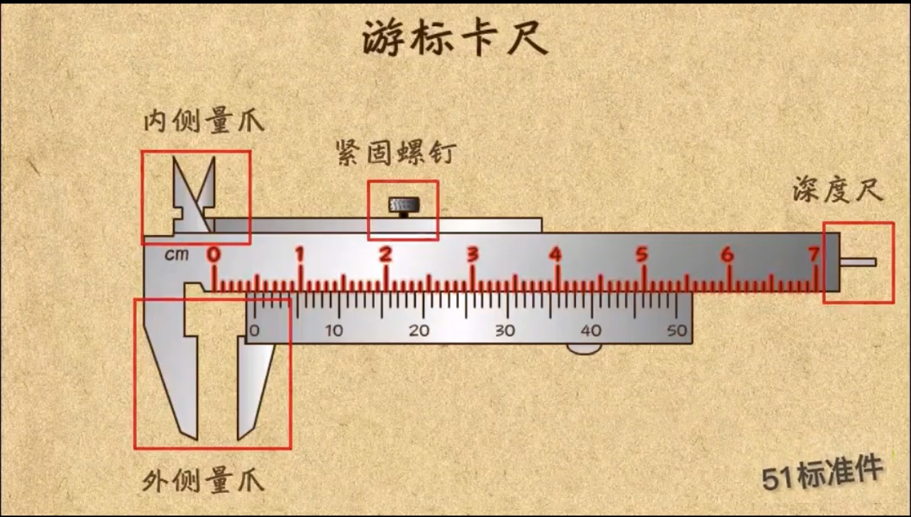

# 元器件测量新手指南

**给：第一次拿卡尺的你　|　任务：把到货的元器件量一遍，填表+拍照发群**

你不需要懂电子。每个零件"长什么样、量哪几个数、怎么量"下面都写死了，照着做就行。量错没关系，**拍清楚照片**我们就能帮你核对。全程注意：轻拿轻放，小零件放盒子里别丢，**不要掰、不要拆、不要剪**任何东西。

---

## 一、认识你的工具：数显卡尺

一把卡尺有 4 个量法，本任务只会用到前 3 个：

| 部位 | 长什么样 | 用来量 |
|---|---|---|
| **外测量爪（大爪）** | 下方一对大钳口 | 物体的**外**尺寸：长、宽、厚、外径 |
| **内测量爪（小爪）** | 上方一对小钳口（尖朝外） | **孔的内径**、槽宽：把小爪伸进孔里撑开 |
| **深度杆** | 尺尾伸出的细杆 | 孔深、台阶高 |
| 显示屏+按键 | 数字屏，有 ON/OFF 和 ZERO | 读数；**ZERO=归零** |

**用前 3 步检查**：① 按 ON，单位确认是 **mm**（不是 in）；② 把大爪合拢贴紧，读数应为 **0.00**，不是就按 **ZERO** 归零；③ 滑动顺滑、爪口无脏东西。

**测量 4 条铁律**：

1. **轻夹**：爪贴到零件就停，别用力捏（捏了读数偏小、还会捏坏小件）。
2. **不歪**：卡尺和零件摆正，歪了读数偏大。
3. **读稳定值**：数字不跳了再读，记到 **0.1mm**（如 42.0）。
4. **量 3 次取中间**：同一个数重复量 3 次，填中间那个值。

---

## 二、逐件测量卡片

> 每张卡片：**认**（长什么样）→ **量**（哪几个数、用哪个爪）→ **参考**（采购标称，仅供你对照有没有量错数量级，**表里填你的实测值**）→ **拍**（照片要求）。

### B1　GT2 同步带（黑色橡胶齿圈）

- **认**：一圈黑色橡胶带，内侧有一排小齿，像皮带。
- **量**：① **带宽**：外爪夹带的宽边 → 参考 6；② **齿距**：用外爪量**连续 10 个齿**的总长再 ÷10 → 参考 2.0；③ **周长**：拿一根细绳绕带子内圈一圈、做记号，再把绳拉直量绳长 → 参考 188。
- **拍**：带子平放整圈一张 + 绳量周长一张。

### B2　6806 轴承（金属圆环）×2

- **认**：银色金属圆环，能转，两面有金属薄片盖住。
- **量**（每个轴承都量）：① **外径**：外爪夹外圆 → 参考 42；② **内径**：小爪伸进内孔撑开 → 参考 30；③ **宽度**：外爪夹环的侧面厚度 → 参考 7。
- **看**：两面是不是**金属盖**（不是橡胶黑盖）→ 表里填"金属盖/橡胶盖"。
- **拍**：正面一张（看到两面盖）+ 卡尺夹外径读数一张。
- **注意**：别拆盖、别用力捏、别摔。

### B3　MG90S 舵机（黑色方盒带耳朵）

- **认**：黑色小方盒，一边伸出两片带孔的"耳朵"，顶上一根能转的轴；附几个白色/黑色塑料舵盘。
- **量**：① **本体长×宽**：外爪夹方盒主体（不含耳朵）→ 参考 22.4×12.5；② **含耳总长**：外爪夹两耳最外端 → 参考 31.8；③ **耳孔中心距**：小爪撑一个孔量孔径，再外爪量两孔**外边缘**距离，中心距＝外边缘距−孔径 → 参考 27.7；④ **耳孔直径**：小爪撑孔 → 实测填表（无标称）；⑤ **底面到耳上表面高**：外爪 → 参考 22.8。
- **拍**：整只一张（看到耳朵和轴）+ 耳孔特写一张。

### B4　INMP441 麦克风模块（小圆板带针）×2

- **认**：直径约 1.4cm 的**小圆电路板**，焊着一排金色排针；板底面中心有一个**小孔**。
- **量**（每个都量）：① **圆板直径**：外爪 → 参考 14；② **板厚**：外爪轻夹板边 → 实测；③ **含排针总高**：板平放桌面，外爪从桌面夹到排针顶 → 实测；④ **两排焊孔中心距**：外爪量两排孔中心 → 参考 7.62。
- **看**：翻过来**底面中心的小孔**在不在正中心 → 拍照让我们看。
- **拍**：正面一张 + **底面小孔特写一张（最重要）**。
- **注意**：拿板边，别摸底面小孔、别弯排针。

### B5　扬声器（圆喇叭）

- **认**：圆形小喇叭，正面黑色振膜，侧面伸出两片金属焊片。
- **量**：① **外圈直径**：外爪夹圆边 → 参考 40；② **总厚（含焊片）**：外爪轻夹最厚处 → 参考 17，若超过 17 填实测并备注"焊片突出"。
- **拍**：正面一张 + 侧看焊片一张。

### B6　轻触开关（小方按钮）

- **认**：6mm 见方的小黑/白方块，顶上一个圆按钮，底面 4 根脚。
- **量**：① **底面长×宽**：外爪 → 参考 6×6；② **总高**：外爪 → 参考 5（若不是 5 一定备注实际值）；③ **脚距**：外爪量对角两脚中心 → 实测。
- **拍**：平放一张 + 侧看高度一张。

### B7　MAX98357A 功放模块（小方板带排针）

- **认**：约 2cm 见方的小电路板，一面有黑色芯片，边上一排金色排针和两个大焊孔（接喇叭）。
- **量**：① **板宽×长**：外爪 → 参考 17.7×19.1；② **两安装孔中心距**：外爪量两孔外边缘−孔径 → 参考 12.6；③ **安装孔直径**：小爪撑孔 → 实测；④ **板厚**、**含排针总高**：外爪/桌面法 → 实测。
- **拍**：正面一张 + 背面一张 + 卡尺读数一张。
- **注意**：拿板边，别摸芯片和焊点。

### C1　螺钉（M2.5 / M3 各一包）

- **认**：金属小螺丝，圆头、内六角孔。
- **量**（M2.5、M3 各挑一支）：① **头径**：外爪夹头部 → 实测；② **头高**：外爪 → 实测；③ **杆长**：外爪 → 对照包装标称（如 M3×12）。
- **拍**：一包整照 + 一支卡尺读数照。

### C2　尼龙平垫圈（白色塑料小圈）

- **量**（M2.5、M3 各一个）：① **内径**：小爪撑内孔 → 实测；② **外径**：外爪 → 参考 M3=6、M2.5=5；③ **厚**：外爪轻夹 → 参考 M3=0.3、M2.5=0.5。
- **拍**：一堆整照 + 一个卡尺照。

### C3　M2.5 六角螺母（金属六方小块）

- **量**：① **对边宽**：外爪夹两个平行面 → 实测；② **厚**：外爪 → 实测。
- **拍**：整包一张 + 一个卡尺一张。

### C4　M3×70 长螺钉套装

- **数**：一套里**有没有配螺母**？有几个？→ 填"有/无+数量"。
- **量**：① **杆长**：外爪 → 参考 70；② **总长含头**：外爪 → 参考约 73。
- **拍**：一套摊开一张。

### C5　PET 编织护套（灰黑软管网套）

- **认**：可以掰开裹线的编织网管。
- **试**：把**那 11 根细线捆在一起**塞进护套，看松还是紧 → 填"松/刚好/紧/塞不进"。
- **量**：捆好的线束**外径**（外爪轻夹）→ 实测。
- **拍**：线束塞进护套一张。

### C6　硅胶片 / EPDM 泡棉（软片材）

- **量**：① **厚**：外爪**很轻**夹（软材料捏了会薄）→ 参考硅胶 2、EPDM 1；
- **看**：一面有没有**背胶**（撕开一角看有无胶层/离型纸）→ 填"有背胶/无"。
- **拍**：撕角特写一张。

### C7　安装柱（若到货）

- **量**：高、外径 → 实测。**没到货就在表里写"未到货"。**

---

## 三、记录表（抄一份或打印填）

| 编号 | 项目 | 实测值(mm) | 参考值 | 照片编号 | 备注 |
|---|---|---|---|---|---|
| B1 | GT2 带宽 / 齿距 / 周长 | 　/　/　 | 6 / 2.0 / 188 |  |  |
| B2 | 轴承① 外径/内径/宽/盖 | 　/　/　/　 | 42/30/7/金属盖 |  |  |
| B2 | 轴承② 外径/内径/宽/盖 | 　/　/　/　 | 42/30/7/金属盖 |  |  |
| B3 | 舵机 本体/含耳/孔距/孔径/耳高 | 　/…　 | 22.4×12.5/31.8/27.7/—/22.8 |  |  |
| B4 | 麦① 直径/板厚/含针高/孔距/底孔居中? | 　/…　 | 14/—/—/7.62/是 |  |  |
| B4 | 麦② 同上 | 　/…　 | 同上 |  |  |
| B5 | 扬声器 直径/总厚 | 　/　 | 40/17 |  |  |
| B6 | 开关 长宽/高/脚距 | 　/　/　 | 6×6/5/— |  |  |
| B7 | 功放 板宽长/孔距/孔径/板厚/含针高 | 　/…　 | 17.7×19.1/12.6/—/—/— |  |  |
| C1 | M3 螺钉 头径/头高；M2.5 头径/头高 | 　/…　 | — |  |  |
| C2 | M3 垫 内/外/厚；M2.5 内/外/厚 | 　/…　 | —/6/0.3；—/5/0.5 |  |  |
| C3 | 螺母 对边/厚 | 　/　 | — |  |  |
| C4 | M3×70 含螺母?/杆长/总长 | 　/　/　 | 有?/70/73 |  |  |
| C5 | 护套 9线塞入松紧/线束外径 | 　/　 | 松紧主观/— |  |  |
| C6 | 硅胶厚/背胶；EPDM厚/背胶 | 　/…　 | 2/—；1/— |  |  |
| C7 | 安装柱 高/外径（或"未到货"） | 　/　 | — |  |  |

---

## 四、回传与收尾

1. 照片命名：`编号_项目`（如 `B4_麦1底孔`）。
2. 表+照片一起发**团队群**，@ 学长/学姐。
3. 拿不准的：**先拍照再问**，别自己猜着填。
4. 量完所有零件**放回原袋/原盒**，轴承和麦克风放最里面别压。

**三条底线**：不掰不拆不剪；轻夹不使劲；每个数读 3 次填中间值。做到这三条，你量的数据就能直接用。谢谢学妹！
